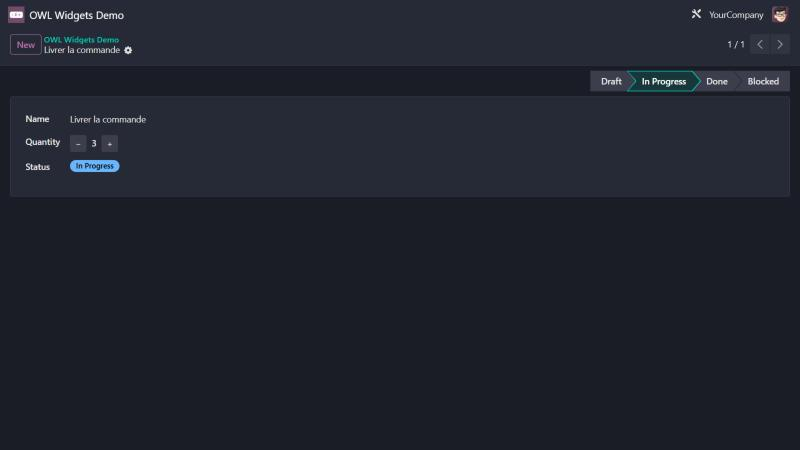

# Odoo OWL Widgets Demo

[](https://github.com/Junmodeste/odoo-owl-widgets-demo/actions/workflows/tests.yml)
[](https://www.odoo.com)
[](LICENSE)

🇫🇷 [Français](#français) · 🇬🇧 [English](#english)

## Français

Le module `odoo_owl_counter_widget` montre, avec un code commenté en français, comment écrire des widgets de champ OWL pour Odoo 17.
Il fournit `counter` (entier avec boutons − / +, sans boutons en lecture seule) et `status_badge` (champ selection affiché en badge coloré), ainsi qu'un petit modèle de démo pour les essayer.



### À lire

| Fichier | Contenu |
|---|---|
| [`counter_field.js`](odoo_owl_counter_widget/static/src/counter_field/counter_field.js) | Composant, `standardFieldProps`, `record.update()`, `extractProps`, enregistrement dans `registry.category("fields")` |
| [`counter_field.xml`](odoo_owl_counter_widget/static/src/counter_field/counter_field.xml) | Template OWL, `props.readonly`, `t-on-click` |
| [`status_badge_field.js`](odoo_owl_counter_widget/static/src/status_badge_field/status_badge_field.js) | Libellé lu dans la définition du champ, couleurs par défaut et option `colors` |
| [`__manifest__.py`](odoo_owl_counter_widget/__manifest__.py) | Déclaration des assets `web.assets_backend` et `web.qunit_suite_tests` |
| [`owl_widgets.test.js`](odoo_owl_counter_widget/static/tests/owl_widgets.test.js) | Tests JS QUnit (`makeView`, `click`, `assert`) |

Utilisation dans une vue :

```xml
<field name="quantity" widget="counter" options="{'step': 5}" readonly="state == 'done'"/>
<field name="state" widget="status_badge" options="{'colors': {'done': 'success'}}"/>
```

### Prérequis

- Odoo 17 (Community ou Enterprise) ; seul le module `web` est requis

### Installation

1. Copiez `odoo_owl_counter_widget` dans votre chemin d'addons.
2. Mettez à jour la liste des applications puis installez **OWL Widgets Demo**.
3. Ouvrez le menu **OWL Widgets Demo** et créez une tâche.

Tests JS : connecté en administrateur, ouvrez `/web/tests?filter=odoo_owl_counter_widget`. Le test Python `tests/test_js.py` les lance aussi dans Chrome headless (il est ignoré si Chrome n'est pas installé).

### Versions supportées

Cette branche : Odoo **17.0**. Autres branches : [`19.0`](https://github.com/Junmodeste/odoo-owl-widgets-demo/tree/19.0), [`18.0`](https://github.com/Junmodeste/odoo-owl-widgets-demo/tree/18.0). Testé sur Odoo 17 Community (image `odoo:17` 17.0-20260908), à chaque push par GitHub Actions. La CI lance les tests Python ; les tests JS QUnit y sont ignorés (pas de Chrome dans l'image), lancez-les dans le navigateur.

### Licence

[LGPL-3](LICENSE)

### Auteur

Koffi Modeste Junior — [@Junmodeste](https://github.com/Junmodeste)

## English

The `odoo_owl_counter_widget` module shows, with code commented in French, how to write OWL field widgets for Odoo 17.
It ships `counter` (integer with − / + buttons, no buttons when read-only) and `status_badge` (selection field shown as a colored badge), plus a small demo model to try them.

### What to read

| File | Topic |
|---|---|
| [`counter_field.js`](odoo_owl_counter_widget/static/src/counter_field/counter_field.js) | Component, `standardFieldProps`, `record.update()`, `extractProps`, registration in `registry.category("fields")` |
| [`counter_field.xml`](odoo_owl_counter_widget/static/src/counter_field/counter_field.xml) | OWL template, `props.readonly`, `t-on-click` |
| [`status_badge_field.js`](odoo_owl_counter_widget/static/src/status_badge_field/status_badge_field.js) | Label read from the field definition, default colors and `colors` option |
| [`__manifest__.py`](odoo_owl_counter_widget/__manifest__.py) | `web.assets_backend` and `web.qunit_suite_tests` asset declarations |
| [`owl_widgets.test.js`](odoo_owl_counter_widget/static/tests/owl_widgets.test.js) | QUnit JS tests (`makeView`, `click`, `assert`) |

### Requirements

- Odoo 17 (Community or Enterprise); only the `web` module is required

### Installation

1. Copy `odoo_owl_counter_widget` into your addons path.
2. Update the apps list and install **OWL Widgets Demo**.
3. Open the **OWL Widgets Demo** menu and create a task.

JS tests: logged in as administrator, open `/web/tests?filter=odoo_owl_counter_widget`. The Python test `tests/test_js.py` also runs them in headless Chrome (skipped when Chrome is not installed).

### Supported versions

This branch: Odoo **17.0**. Other branches: [`19.0`](https://github.com/Junmodeste/odoo-owl-widgets-demo/tree/19.0), [`18.0`](https://github.com/Junmodeste/odoo-owl-widgets-demo/tree/18.0). Tested on Odoo 17 Community (`odoo:17` image 17.0-20260908) on every push by GitHub Actions. CI runs the Python tests; the QUnit JS tests are skipped there (no Chrome in the image), run them in the browser.

### License

[LGPL-3](LICENSE)

### Author

Koffi Modeste Junior — [@Junmodeste](https://github.com/Junmodeste)
